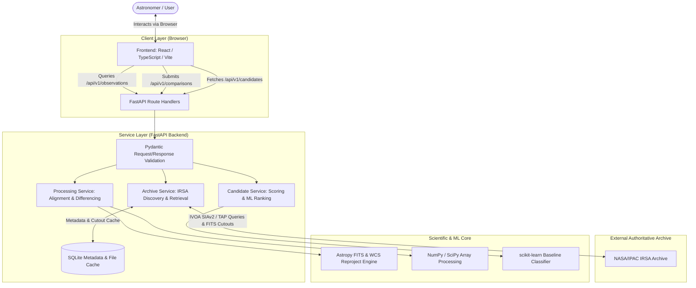

# SPHEREx TimeLens — System Architecture

This document defines the high-level system architecture, component boundaries, data flow, provenance tracking, and error handling for the **SPHEREx TimeLens** application.

---

## 1. System Overview & Architectural Boundaries

SPHEREx TimeLens is structured as a decoupled monorepo composed of a reactive web client, an astronomical REST API service, and scientific processing subsystems.

---

## 2. Responsibilities of Frontend vs. Backend

To guarantee scientific accuracy and maintain lightweight client performance across diverse hardware (e.g., standard laptops), a strict division of responsibility is enforced:

### Frontend Responsibilities
* **User Interaction**: Celestial coordinate input (Right Ascension / Declination, radius, search targets), epoch selection, and filter adjustments.
* **State Management**: Managing active query parameters, comparison sessions, and visual inspection toggles.
* **Visualization**: Rendering pre-stretched display previews (PNG/WebP), side-by-side epoch comparisons, synchronized panning/zooming, difference previews, and candidate tables.
* **Scientific Boundaries**: **The frontend must not parse raw multi-megabyte FITS files, perform WCS reprojection, calculate astronomical coordinates, or perform numerical matrix differencing.** All scientific logic resides exclusively in the backend.

### Backend Responsibilities
* **Archive Interoperability**: Formulating standards-compliant IVOA SIAv2 / TAP queries to query official NASA/IPAC IRSA public SPHEREx tables.
* **FITS Validation**: Parsing FITS headers, validating celestial WCS coordinate systems, verifying photometric calibration units, checking detector quality masks, and extracting spatial cutouts.
* **Scientific Comparison**: Performing WCS reprojection onto a common reference grid, flux scale normalization, background subtraction, invalid-pixel masking, and error-propagated image subtraction.
* **Preview Rendering**: Generating display-ready, histogram-equalized or asinh/zscale stretched image cutouts for instant client visualization.
* **Candidate Scoring**: Extracting candidate spatial and photometric features and evaluating them using rule-based metrics and baseline ML models.
* **Provenance Serialization**: Packaging complete processing history, archive identifiers, observation times, and uncertainty metrics into strongly typed Pydantic responses.

---

## 3. End-to-End Data Flow

The lifecycle of an astronomical comparison request follows eight discrete steps:

1. **Target Search**: The user inputs sky coordinates (RA/Dec in degrees or sexagesimal) or an astronomical object identifier. The frontend sends a request to `GET /api/v1/observations`.
2. **Archive Discovery**: The backend queries the NASA/IPAC IRSA catalog using IVOA SIAv2 protocols. It retrieves metadata records for all available SPHEREx visits covering the target position.
3. **Observation Compatibility Check**: The backend evaluates available candidate pairs to determine if they meet scientific compatibility rules (spatial overlap, wavelength band compatibility, distinct observation epochs). Compatible pairs are presented to the user.
4. **Comparison Submission**: The user selects a reference observation and a target observation and sends `POST /api/v1/comparisons`.
5. **Data Retrieval & Caching**: The backend checks the local cache. If missing, it downloads small, targeted FITS cutouts from IRSA and stores them in the local cache with metadata registered in SQLite.
6. **Scientific Preprocessing & Differencing**:
   - The backend validates WCS headers and masks non-science pixels (bad pixels, saturated pixels, cosmic rays).
   - The target image is reprojected onto the reference WCS grid.
   - Background levels are estimated and normalized.
   - The calibrated difference image and error propagation maps are computed.
7. **Candidate Feature Extraction & Ranking**:
   - Connected-component extraction identifies candidate residual anomalies.
   - Morphological and photometric features are extracted (peak significance, flux ratio, circularity, PSF-fit residual).
   - The baseline ML classifier assigns candidate ranking scores and false-positive flags.
8. **Delivery & Visualization**: The backend returns a typed comparison response with URLs to display previews, the list of ranked candidate anomalies, and full provenance records. The frontend displays the side-by-side and difference views.

---

## 4. Observation Epochs vs. Product Releases

A critical scientific distinction is maintained throughout the system architecture:

| Concept | Definition | SPHEREx Example | Usage in TimeLens |
| :--- | :--- | :--- | :--- |
| **Observation Epoch** | The physical time when the instrument detector was exposed to photons. | `DATE-OBS = 2025-04-12T14:32:01.201Z`, `MJD = 60777.6055` | **The sole determinant of temporal baseline.** Used to order observations chronologically and detect physical variation. |
| **Product Release** | The pipeline version, software calibration release, or data drop identifier from the SPHEREx Science Data Center. | `QR2` (Quick Release 2), `QR3`, `DR1` | **A metadata provenance label only.** Multiple releases of the same observation reflect improved calibrations, not physical time evolution. Never treat release labels as epochs. |

Comparing two images of the same sky region from `QR2` and `QR3` taken during the *same exposure* measures pipeline calibration differences, **not** astronomical transient phenomena. The backend enforces validation to prevent comparing different processing runs of identical observation timestamps as if they were temporal baselines.

---

## 5. Data Provenance & Auditability

To ensure reproducibility, every processing output includes a comprehensive provenance record containing:

* **Primary Archive Identifiers**: Specific IRSA observation ID, product URI, and data release version.
* **Temporal Context**: Observation start time (`DATE-OBS`), integration time (`EXPTIME`), and Julian Date (`MJD`).
* **Instrument Parameters**: Spectral band identifier, nominal center wavelength ($\mu m$), and resolution.
* **Spatial Parameters**: Reference WCS coordinate system, projection type (e.g., TAN, STG), pixel scale, and cutout bounding box.
* **Processing Lineage**: Software version, reprojection algorithm, background estimation method, masking thresholds applied, and differencing parameters.
* **Uncertainty Quantification**: Measured local background noise ($\sigma$), residual variance, and candidate detection significance.

---

## 6. Error Handling & Scientific Uncertainty

Astronomical data analysis inherently encounters noisy, incomplete, or corrupted records. The architecture handles these gracefully:

* **Archive Unavailability / Timeouts**: Network failures or archive maintenance return structured HTTP 502/504 errors with user-friendly retry guidance.
* **Incompatible Observations**: If a user requests comparison of observations with incompatible bands (e.g., Band 1 vs. Band 6) or zero spatial overlap, the backend rejects the request with HTTP 422 and a detailed explanation of the incompatibility.
* **Artifact vs. Detection Uncertainty**: If an extracted difference feature falls close to the noise threshold ($3\sigma - 5\sigma$) or exhibits morphology characteristic of optical diffraction spikes or registration artifacts, it is flagged as uncertain. **The system never converts ambiguous residuals into positive discoveries.**
